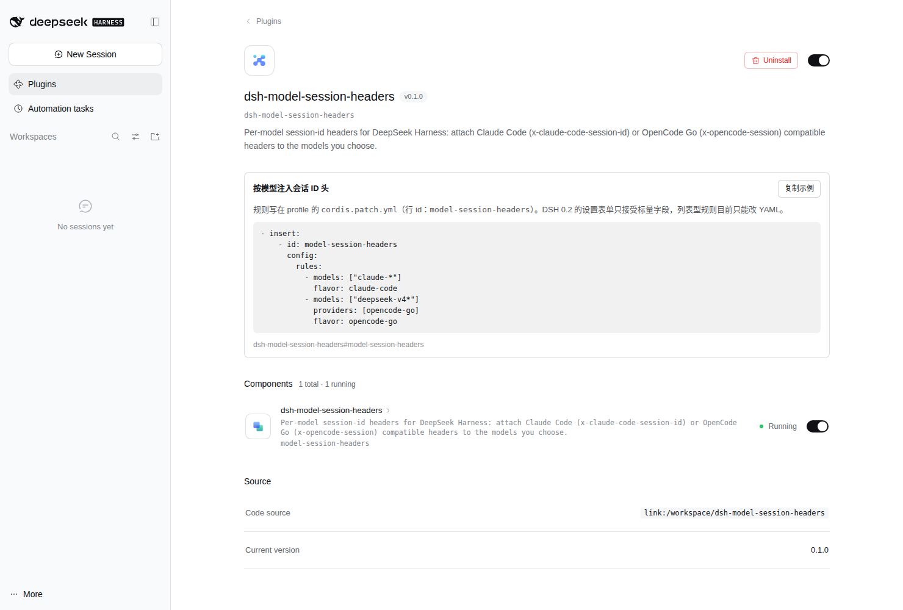

# dsh-model-session-headers

给 **DeepSeek Harness (DSH)** 用的插件：**按模型**（而不是按 provider 路由）给发往网关的请求附加会话 ID 头，内置两种生态的写法：

| 生态 | 请求头 | 谁在读 |
| --- | --- | --- |
| Claude Code | `x-claude-code-session-id` | Claude Code 兼容网关 / 中转（按会话聚合流量、计费、粘性路由） |
| OpenCode Go | `x-opencode-session` | OpenCode / OpenCode Go（缺头会 `400 MissingSessionID`，同值请求粘在同一后端以保 prompt cache） |
| 通用 | `x-session-id` | LiteLLM / one-api 等自建中转 |

同一个 provider 路由下的两个模型可以走两套头：`claude-*` 发 Claude Code 头，`deepseek-*` 发 OpenCode 头，互不干扰。

## 为什么需要它

DSH 没有"单请求头"的扩展点：`GenerateOptions` 里没有 headers 字段，每个适配器在 `stream()` 内部自己拼 wire headers。本插件组合两个官方拦截点补上这一层：

1. `llm/stream` waterfall —— 拿到这次调用的 `options.provider` / `options.model` / `options.sessionId`；
2. 打补丁的 `globalThis.fetch` —— 真正把头写进出站请求。

`AsyncLocalStorage` 把补丁的作用域限定在这一次流式调用内，所以 Web RPC、遥测、工具请求等无关 fetch 完全不受影响。

和"provider 级请求头"类插件的区别：那类插件只能对整个路由生效，无法区分同一路由下的不同模型；本插件按模型 id 匹配，粒度更细。

## 安装

```bash
# 本地目录（开发时用，link 安装，改完重启 DSH 即生效）
dsh plugin --profile web add /abs/path/to/dsh-model-session-headers

# 或从 git
dsh plugin --profile web add github:jiangwennn/dsh-model-session-headers
```

装完重启 profile（bundle 层在启动时读取）。确认层已生效：

```bash
dsh --profile web --dump-config | grep model-session-headers
```

## 设置界面

web profile 里，打开「设置 → 插件 → Installed plugins → dsh-model-session-headers」，可以直接编辑规则：添加/删除、填模型 glob、选 flavor、启用开关。保存后**无需重启**，下一次模型调用即生效。



保存写入的是 profile 的 `cordis.patch.yml`（行 id `model-session-headers`），与手写 YAML 完全等价，两种方式可以混用。

实现上有两个坑，都已在代码里处理：

- `rules` 必须声明 `.volatile()`，否则 `SettingsForms.write()` 以 `not volatile` 拒绝写入；但 volatile 字段会被 DSH 换成 **observable** 传给插件，直接 `.filter()` 会抛错，所以读取统一走 `unwrapRules()`。
- 插槽渲染器以普通函数调用的方式执行组件，**函数组件里的 React hooks 不生效**（组件静默不渲染），所以卡片写成 class 组件。

## 对话右上角的发送状态

每个对话的头部右侧（「后台任务」按钮旁边）会显示一个状态标记：圆点 + 最近一次请求的头名称。

| 圆点 | 含义 |
| --- | --- |
| 绿 | 已发送：DSH 已带上这个头发出请求 |
| 黄 | 跳过：请求里已有同名头且 `overwrite` 关闭，保留了原值 |
| 灰 | 未命中规则，或还没有请求记录 |

点开后列出会话 id 和这个对话最近 10 次请求：时间、provider / 模型、状态、实际发出的头和值（跳过时显示已存在的值）。

- **默认开启**。在设置卡片里取消「在对话右上角显示发送状态」即可关闭，保存后无需重启；关闭期间不再记录。等价 YAML：`showStatus: false`。
- 记录只在内存中，每个对话最多 10 条、最多保留 100 个对话，DSH 重启后清空。
- 没有会话 id 的内部辅助请求无法归属到某个对话，不会出现在列表里。
- 只能证明 **DSH 这一跳**已发出。中间网关（如 magpie）是否把头转发给上游，这里看不到——那需要看网关自己的日志。

实现：host 端注册只读接口 `GET /model-session-headers/api/status?session=<id>`，经 `connection.requestRejection` 做浏览器信任校验；前端每 3 秒（页面不可见时暂停）按**页面自身的 base** 解析相对路径请求它——desktop 页面是 `dsh-app://app/`，直接请求 host 的 `127.0.0.1` 源会因跨域被浏览器拦截。

## 配置

写在 profile 的 `cordis.patch.yml`（或本包自带的同名文件，安装后按 id 覆盖整个 `config`，需写全量）：

```yaml
- insert:
    - id: model-session-headers
      name: dsh-model-session-headers
      config:
        mode: session-id        # session-id | uuid | fixed
        keepPrefix: false
        overwrite: false
        debug: false
        rules:
          # Claude Code 兼容：所有 claude 系模型
          - models: ["claude-*", "anthropic/claude-*"]
            flavor: claude-code

          # OpenCode Go：只对走 opencode-go 路由的 deepseek 模型
          - models: ["deepseek-v4*"]
            providers: [opencode-go]
            flavor: opencode-go

          # 完全自定义：一个模型挂多套头
          - models: ["my-gateway-model"]
            headers:
              x-session-id: "{sessionId}"
              x-opencode-session: "{sessionId}"
              x-tenant: acme
              x-routing-key: "{provider}/{model}"
```

### 默认规则

未配置 `rules` 时内置两条规则（本包自带的 `cordis.patch.yml` 也写的是这两条）：

| 模型 | flavor | 示例 |
| --- | --- | --- |
| `opencode/*`、`*/opencode/*` | `opencode-go` | `opencode/deepseek-v4.1-flash`、`aihub/opencode/deepseek-v4.1-flash` |
| `claude-*` | `claude-code` | `claude-sonnet-4-6`、`anthropic/claude-sonnet-4-6` |

显式写 `rules: []` 表示停用全部注入；profile 里已有的 `rules` 会整体覆盖默认规则。

### 规则匹配

- 规则**自上而下**求值，**首条命中**生效；未命中任何规则的调用原样透传。
- `models` 支持 `*` / `?` 通配，大小写不敏感。完整 id 和最后一段（`/` 之后）都会参与匹配，所以 `claude-*` 能命中 `anthropic/claude-sonnet-4-6`。
- `models` 留空 = 不限模型；`providers` 留空 = 不限路由；两者都空 = 该规则匹配全部调用（相当于全局）。
- `enabled: false` 可临时停用某条规则。

### 头信息

`flavor` 提供预设，`headers` 在其之上追加或覆盖（同名后者胜）：

| flavor | 默认头 |
| --- | --- |
| `claude-code` | `x-claude-code-session-id: {sessionId}` |
| `opencode-go` | `x-opencode-session: {sessionId}` |
| `generic` | `x-session-id: {sessionId}` |

模板变量：`{sessionId}`、`{model}`、`{provider}`。模板里没有变量时就是固定值。

### 取值语义

| `mode` | 头的值 |
| --- | --- |
| `session-id`（默认） | 本次调用的 DSH 会话 id；默认去掉 `session-` 前缀，只发裸 UUID（`keepPrefix: true` 可保留） |
| `uuid` | 会话 id 的 SHA-256 派生的 UUIDv5 形态，跨进程稳定、对上游不可读 |
| `fixed` | 配置里的 `value`，所有调用相同（`value` 为空则该规则不注入） |

会话 id 缺失的调用（部分内部辅助请求）不注入任何头，不会把空值发出去。

### 覆盖行为

默认**不覆盖**已存在的同名头（HTTP 语义上大小写不敏感），这样适配器自己设置的值优先。某些官方 provider 会写死占位符（如 `x-opencode-session: dsh-web-search`），此时把 `overwrite` 打开（全局或单条规则），或让规则里的 `headers` 覆盖预设。

## 调试

```yaml
debug: true                       # 控制台打印每次注入
debugFile: /tmp/session-headers.jsonl   # 每次注入追加一行 JSON
```

JSONL 每行：`{"ts","provider","model","session","headers"}`。

## 工作原理

```
llm/stream(options, next)
  ├─ selectRule(): provider + model 匹配 → 命中规则
  ├─ buildHeaders(): flavor/headers 模板 → [[header, value], ...]
  └─ 每次 iterator.next() 都在 als.run(scope) 内执行
        └─ 适配器内部 fetch()
              └─ 补丁后的 fetch: 读 als store → 合并 headers → 发请求
```

- `ctx.on('llm/stream')` 与 `ctx.effect()` 都是可逆注册，卸载插件时自动移除监听并还原 `fetch`（若期间被别的插件再次替换则不强行还原，只告警）。
- 合并 headers 覆盖两种 fetch 写法：`Request` 对象自带的 headers，以及 `init.headers` 覆盖。

## 限制

- 只覆盖 `llm/stream` 内的对话/流式请求。`GET /models` 这类模型发现请求是独立流程，不会带头；如果网关连列表接口都拒绝，需要另做适配。
- 依赖 DSH 出站 LLM 请求走 Node 全局 `fetch`。未来若 DSH 换网络栈，注入会失效（症状是原来的缺头报错回归）。
- 不伪造 TLS 指纹、`user-agent`、`anthropic-beta` 等其他头；需要时用规则的 `headers` 显式添加。
- 不把内部会话 id 泄露给第三方：只有命中规则的出站请求会被改写，其他 fetch 原样通过。

## 开发

```bash
npm install
npm test        # node:test，含本地 echo server 的端到端断言
```

无构建步骤，`index.js` 即产物。

## 已验证

- DSH `0.2.1-rc.2`（Node 24）：`dsh plugin --profile web add <dir>` 安装成功，`--dump-config` 中可见 `# == dsh-model-session-headers` 层，web profile 启动时 `apply` 被真实调用。
- 16 个本地测试通过，含 `llm/stream` → 补丁 fetch → echo server 的端到端断言（Claude Code / OpenCode Go / 未匹配模型 / 不覆盖 / 覆盖 / Request 对象 / 卸载还原）。
- **未**对真实 Claude Code 或 OpenCode Go 网关发过请求。头名按官方文档核对：Claude Code 网关的 `x-claude-code-session-id`、OpenCode 的 `x-opencode-session`。

## License

MIT
